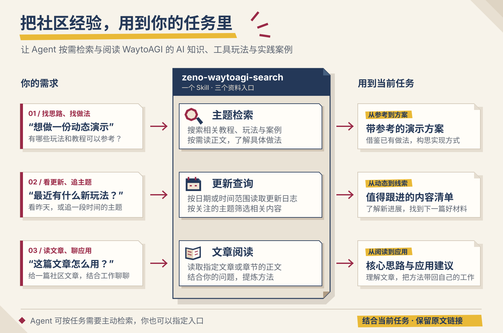

# zeno-waytoagi-search

**让 WaytoAGI 成为你的 Agent 完成任务时的 AI 知识与实践信源。**

构思产品方案、制作内容、搭建工作流，或了解一个 AI 工具时，已有的知识和实践经验可以帮助你找到思路。Agent 可以从 WaytoAGI 知识库检索相关资料、按需阅读文章，并结合当前任务整理建议、方案或回答，保留原文链接。

本仓库由 Zeno 开发，提供 `zeno-waytoagi-search` Skill。使用时不必先说出 WaytoAGI 的名字，也不必明确要求搜索资料；任务中需要补充 AI 知识、工具玩法或实践经验时，Agent 可主动检索。你也可以指定它查资料、看社区更新或读取文章链接。



## 关于 WaytoAGI

[WaytoAGI（通往 AGI 之路）](https://www.waytoagi.com/)是面向中文 AI 学习者、创作者与实践者的知识库和共学社区。它由学习者与共建者持续补充内容，帮助大家从理解 AI 概念走向工具使用和实际应用。

这里既有适合入门的学习路径、教程和工具介绍，也有创作者分享的应用案例、工作流与实践经验。社区还通过共学、活动和共创项目，让学习者交流做法、留下可供他人参考的资料。本 Skill 接入其中的飞书知识库，让这些内容成为 Agent 推进各类任务时可检索、可引用的材料。

[打开知识库](https://waytoagi.feishu.cn/wiki/QPe5w5g7UisbEkkow8XcDmOpn8e) · [了解社区](https://about.waytoagi.com/)

## 安装

复制这句话，交给支持 Skill 的 Agent：

```text
帮我安装并配置这个 Skill：https://github.com/zenokat/zeno-waytoagi-search/tree/main/skills/zeno-waytoagi-search
```

## 你可以这样用

日常任务中，你可以直接描述目标，例如“我要做一份带动态效果的产品演示，先帮我构思实现方式”。Agent 可根据任务需要主动检索相关玩法与案例，再将材料用于方案构思。

下面保留了几次明确请求检索、查更新和读文章的实际回答节选，展示取得的资料如何帮助推进任务。

### 寻找玩法，制作带动态效果的演示文稿

**提问**

```text
我想做一份带动态效果的演示文稿，帮我在社区找找相关的玩法或教程，看看别人是怎么做的。
```

**回答原文节选**

> 可以参考这篇实操教程：[信息的AI可视化（1）：AI生成动态PPT的步骤分享](https://waytoagi.feishu.cn/wiki/W9L0weRLliNQIXkOEAic7aE1nqe?visible_space_id=7226178700923011075)。它先把演示文稿当作 16:9 的 HTML 视觉页面生成，再利用网页本身承载动画效果；正文展示了生成结果的视频。
>
> 作者的做法是：先用自然语言说清风格、配色、画布比例、装饰限制和内容类型，先生成 2 页模板校准；通常经过 3 至 5 轮对话拿到满意模板后，再让模型把当前风格归纳为可复用的样式说明，随后批量生成内容，并在风格跑偏时把样式说明重新提供给模型。
>
> ……

### 学习 Codex，找到适合自己的入门路径

**提问**

```text
我刚开始用 Codex，帮我在社区找几篇入门教程，建议一下先看什么。
```

**回答原文节选**

> 我在社区里读了三篇，建议按“先建立使用感，再认识界面和边界，最后练具体场景”的顺序看：
>
> 1. [Codex 入门介绍教程（中文版）](https://waytoagi.feishu.cn/wiki/AczbwyI67itzBkkPsgqc9Iz4n4d?visible_space_id=7226178700923011075)。最适合第一篇。它面向非技术用户，核心是先找一个低风险、重复且结果容易核对的小任务，例如整理一批文件、合并 CSV 或把资料做成固定格式摘要；先把相关材料放进独立文件夹，再说明期望产出和保存位置。
>
> 2. [万字长文｜Codex 从入门到精通](https://waytoagi.feishu.cn/wiki/XbCCwsMQSipBdvknK2fcGuipnQh?visible_space_id=7226178700923011075)。跑通第一个小任务后再看。它把项目、任务、工作区、权限、计划和 Diff 放到同一张使用地图里，能帮助你理解为什么要先选对目录、给清楚边界，并在完成后检查实际改动。
>
> ……

### 每日更新

**提问**

```text
看看昨天社区更新了什么内容？
```

**回答原文节选**

> 按 Asia/Singapore 时区，昨天是 2026-10-16。社区当天列出了 3 条更新：
>
> ……
>
> [一文讲清：如何用 AI 制作各种办公图表](https://waytoagi.feishu.cn/wiki/YRG5wHyrkih3AGkh8V6cv66GnQe)
>
> 作者带来一套适配飞书文档的 AI 绘图实操方案，区分了 Mermaid 和 HTML 两种绘图方式。Mermaid 快速生成流程图、架构图等可编辑结构图表，方便团队评审修改；HTML 用来制作高颜值、可交互的汇报可视化图表。
>
> ……

### 追踪前沿

**提问**

```text
帮我搜一下社区内近 3 个月最新的 Skills 玩法或教程。
```

**回答原文节选**

> 我按 WaytoAGI 的更新日志日期（Asia/Singapore）检索了 2026-07-17 至 2026-10-17 之间的 Skills 主题条目。下面按日志日期由新到旧列出精选样本；筛选依据是更新日志原标题或摘要中出现 Skill、Skills 或“技能”。
>
> - 2026-10-15：[Opus 5.5 做视频全教程：一段话到成片，16 种风格 Skill 免费开源](https://waytoagi.feishu.cn/wiki/YzJkwQ4QniB4Tdk4YNacUobmngc)。适合想把视频制作流程沉淀为可复用 Skill 的场景；日志摘要提到先生成多版 3 秒样片筛选风格，再渲染全片。
>
> ……
>
> - 2026-08-24：[有趣的小红书图文自动排版Skill，使用教程来喽！](https://waytoagi.feishu.cn/wiki/FQCHw2MzPidJsSkpijYclsSenre)。介绍将文章或飞书链接自动拆页、渲染并导出 2K 图片的排版 Skill。
>
> - 2026-07-25：[一文讲透Agent三件套：MCP、Skill、Hook如何给大模型装上护栏](https://waytoagi.feishu.cn/wiki/Cf0ywD0eXifq7YkwkGdceZBnnd3)。适合补齐 Agent 中工具调用、执行顺序与危险操作拦截等基础概念。
>
> 本次时间以社区更新日志的日期为准；范围覆盖年度归档与当前近 7 日日志中可确认日期的条目。

### 分享社区文章，提炼思路并用于工作

**提问**

```text
我在社区看到这篇文章，想和你一起学一学。先帮我梳理核心思路，再聊聊我可以怎么用到自己的工作里：https://waytoagi.feishu.cn/wiki/AczbwyI67itzBkkPsgqc9Iz4n4d?visible_space_id=7226178700923011075
```

**回答原文节选**

> 这篇《Codex 入门介绍教程（中文版）》的主线不是“先学会编程”，而是把你熟悉的重复工作转成一项可委派、可检查的小任务。
>
> ……
>
> 我们可以从你的一个真实工作动作开始拆：它现在要花多久、输入材料是什么、最终交付给谁、你如何判断结果合格。你愿意先选一个每周至少会做一次、最让你觉得重复的任务吗？我可以和你一起把它改写成一段适合交给 Codex 的任务说明，并一起定义第一轮该检查什么。

## 反馈与交流

使用反馈、问题交流或玩法分享，欢迎在[小红书联系 Zeno](https://www.xiaohongshu.com/user/profile/65057be4000000001603b474)。

## 来源与许可

资料来自 WaytoAGI 知识库，具体总结、推荐和判断由你的 Agent 根据任务完成。

代码和说明文档使用 [MIT 许可证](LICENSE)；引用资料的权利归原作者或相应权利人所有，不随本项目采用 MIT 许可。
